# Hình chọn lọc

Toàn bộ hình sinh lại được bằng các script trong `scripts/` (xem `docs/replication_report.md`).

## Mốc 2: tầng cao riêng, tàu thật bám hoàn hảo tàu ảo

| Hình | Nội dung |
| --- | --- |
|  | Case 1 với **k_v = 0.1 như Paper A**: follower đi đường ngoằn ngoèo suốt 40 s; có lúc hai tàu cách nhau chỉ 0.29 m. |
|  | Case 1 với k_v = 20 (đã chọn): hội tụ trong khoảng 3 s, giữ hình vuông qua cả ba pha co giãn. |
|  | Case 2, quét k_v: chỉ k_v = 40 dập được mode chậm (λ_min = 0.039). |
|  | Case 1, khoảng cách nhỏ nhất giữa hai tàu theo k_v. Cản kém thì tàu tiến sát nhau, đây là động lực cho phần CBF. |

## Mốc 3: chạy kín với plant thật và baseline M1 ([L21] (27) = (62) của Paper A)

| Hình | Nội dung |
| --- | --- |
| 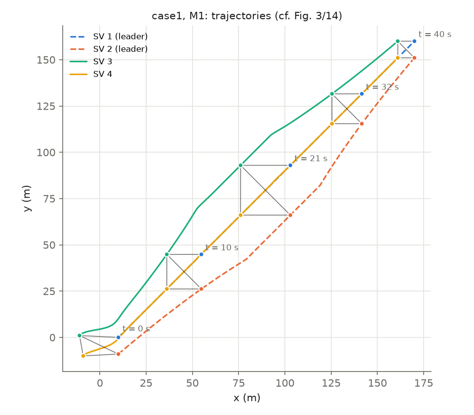 | Case 1, M1: quỹ đạo và các ảnh chụp đội hình (so với Hình 3). |
|  | Case 2, M1 (so với Hình 14). |
|  | Sai số bearing của M1: cấu hình chính và các biến thể. ζ của Paper A cho RMSE gần như y hệt dù bám vận tốc kém: chỉ số bearing không nhạy với tầng thấp. |
|  | Góc hướng: quá độ lớn ở 2 s đầu; xác lập ở khoảng 1.08 rad thay vì π/4, vì M1 không bù mô-men nhiễu δ_r. |
| 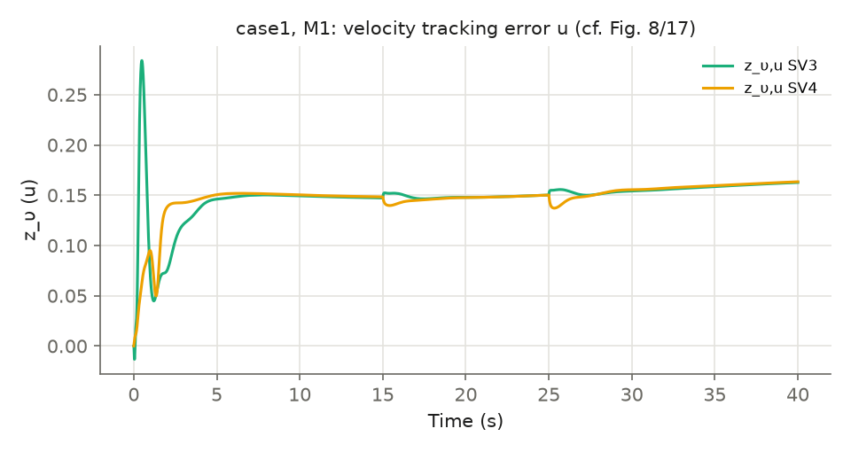 | Sai số vận tốc surge: xác lập khoảng δ_u/k_u ≈ 0.15 m/s (so với Hình 8). |
| 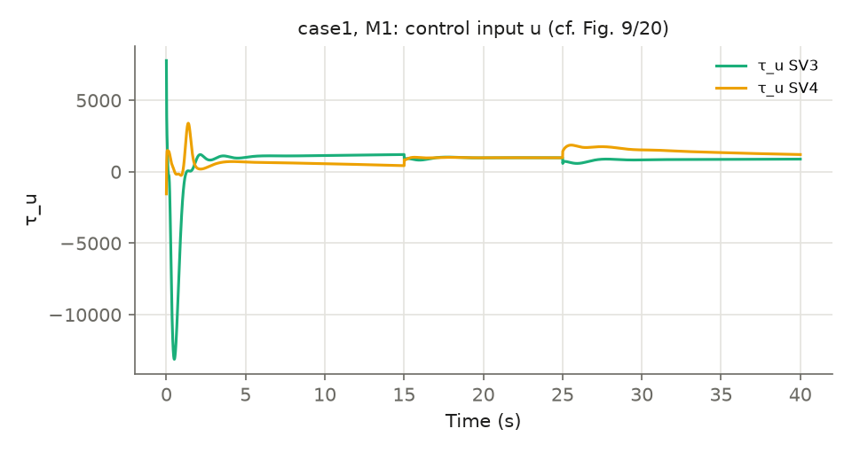 | Lực surge: khoảng 1100 N khi chạy đều, khớp mức lực ở Hình 9a. |

## Mốc 4: IRL trên bài toán đồ chơi

| Hình | Nội dung |
| --- | --- |
| 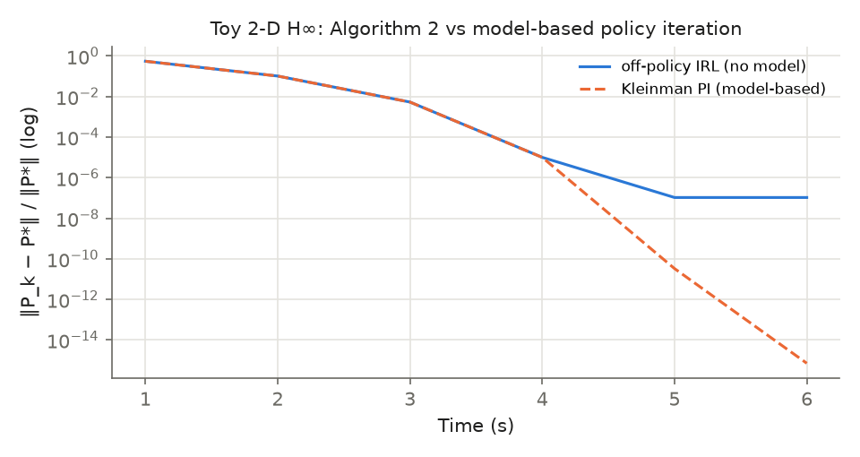 | Bài đồ chơi 2 chiều có nhiễu: Algorithm 2 (không dùng mô hình) trùng với phép lặp chính sách dùng mô hình ở từng vòng, và hội tụ về nghiệm ARE. |

## Mốc 6: Case 1 và Case 2, M1 so với IRL (10 seed)

Dải màu là min–max trên 10 seed IRL; đường xanh là seed đại diện (trung vị dưới của ε_max); đường cam là M1. Bảng số: `../moc6_table.md`.

| Hình | Nội dung |
| --- | --- |
| 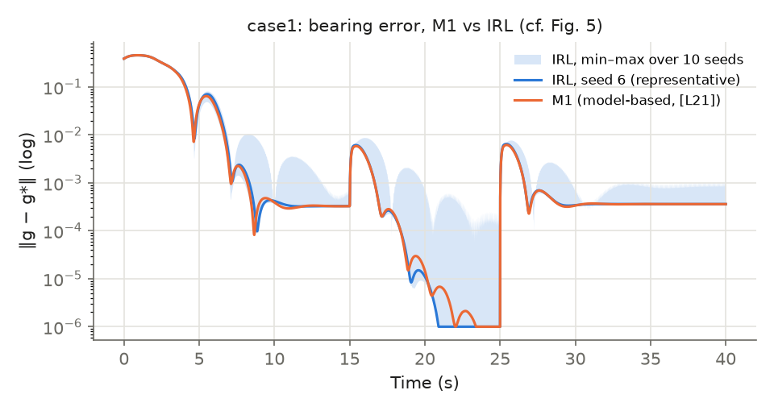 | Case 1: sai số bearing của IRL và M1 gần như trùng nhau (RMSE 0.117 so với 0.116). |
| 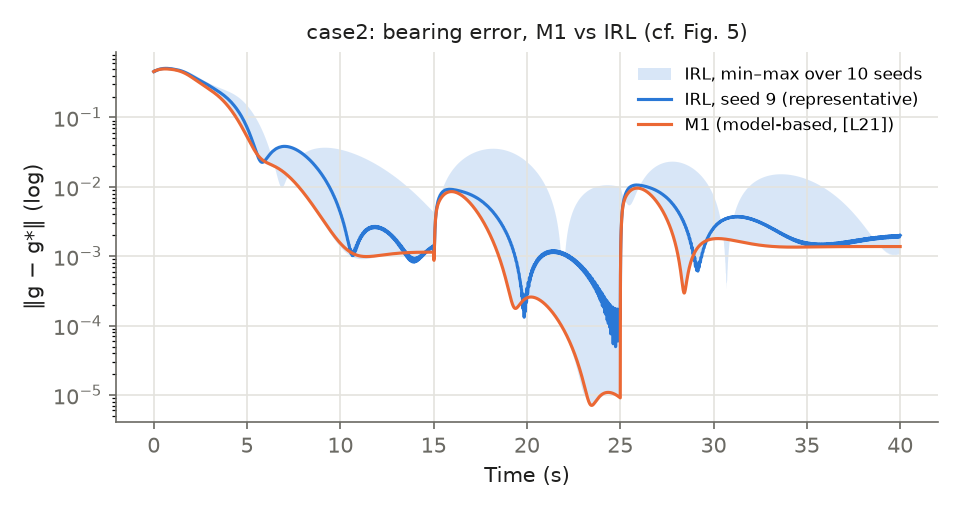 | Case 2: giống Case 1. Sai số dao động quanh ngưỡng 0.01 ở các lần co giãn (t = 15 và 25 s), nên thời gian xác lập theo ngưỡng này không bền. |
| 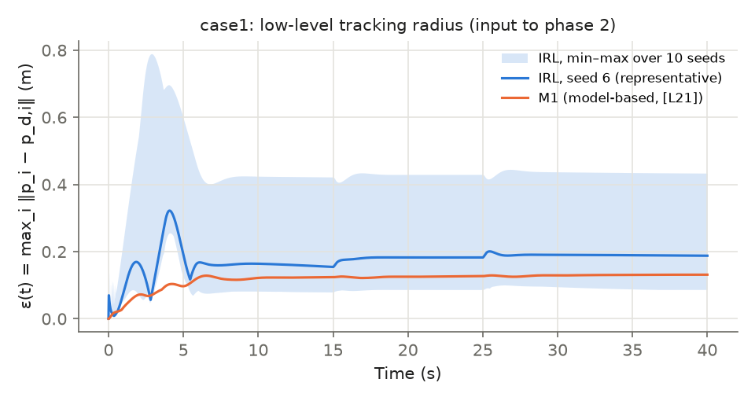 | Bán kính sai số bám ε(t) = max_i ‖p_i − p_d,i‖: bị chặn ở mọi seed (≤ 0.6 m khi t ≥ 5 s), lớn hơn M1 (0.13 m). Đây là đầu vào của giai đoạn 2. |
| 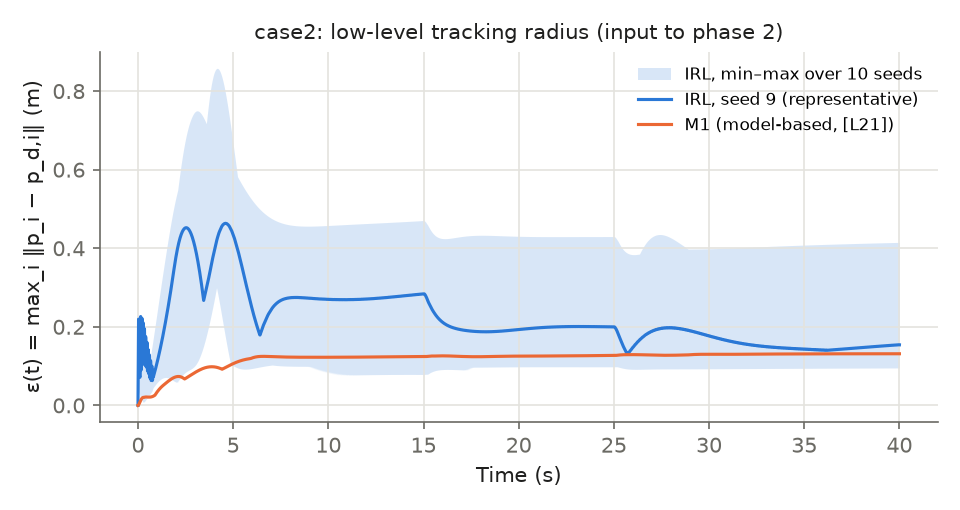 | Case 2: ε ≤ 0.66 m khi t ≥ 5 s; đỉnh quá độ khoảng 0.85 m ở t ≈ 4 s. |
| 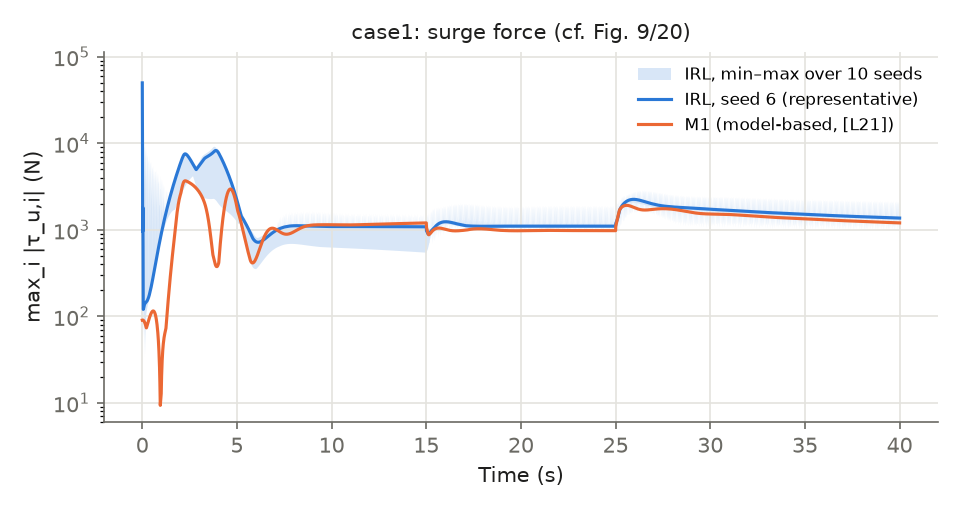 | Lực surge: đỉnh 10⁴–10⁵ N chỉ có ở bước t = 0 (ω_d nhảy bậc, nên z_r ≈ 7 rad/s); khi chạy đều thì khoảng 1100 N, giống M1. |
| 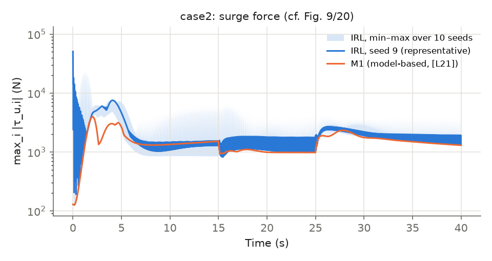 | Case 2, lực surge. |
| 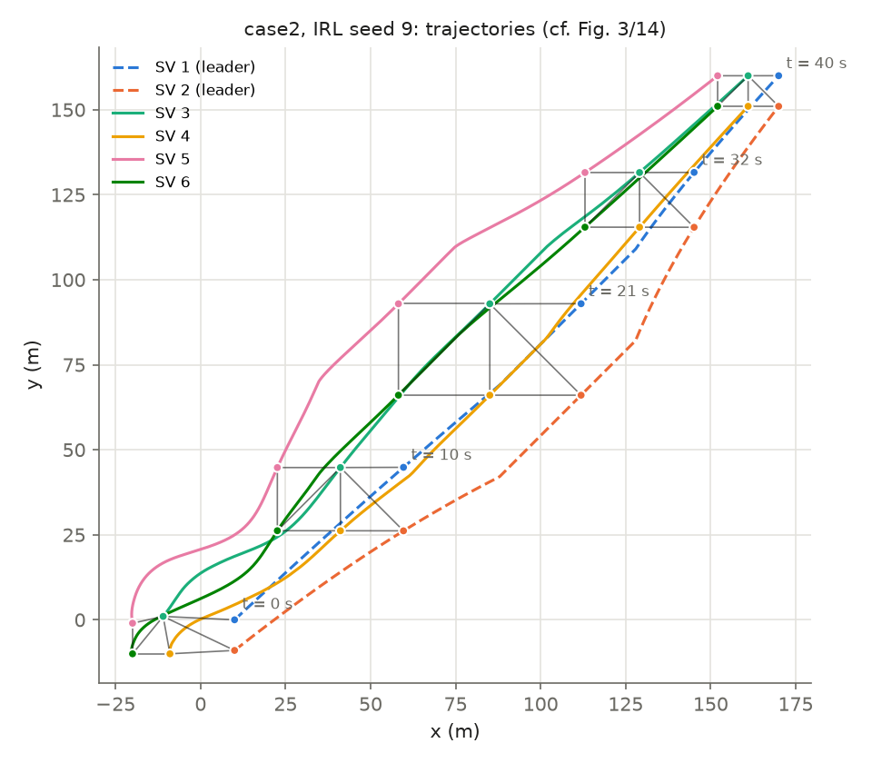 | Case 2, IRL seed đại diện: quỹ đạo (so với Hình 14). |
