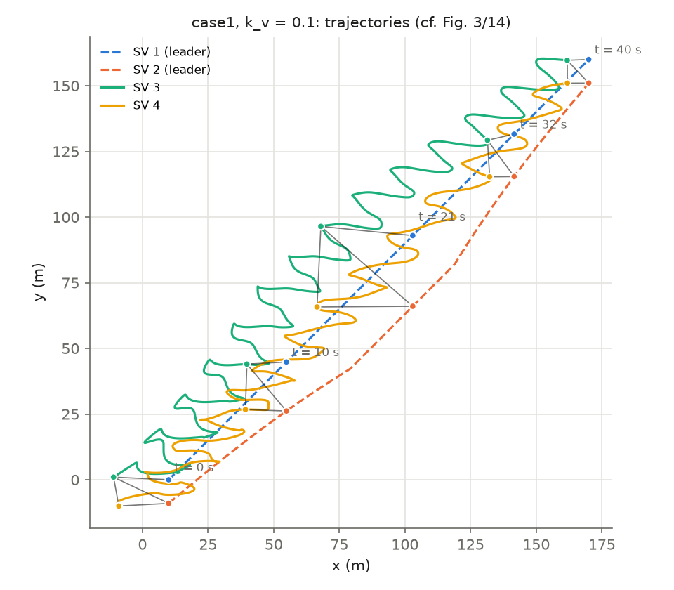
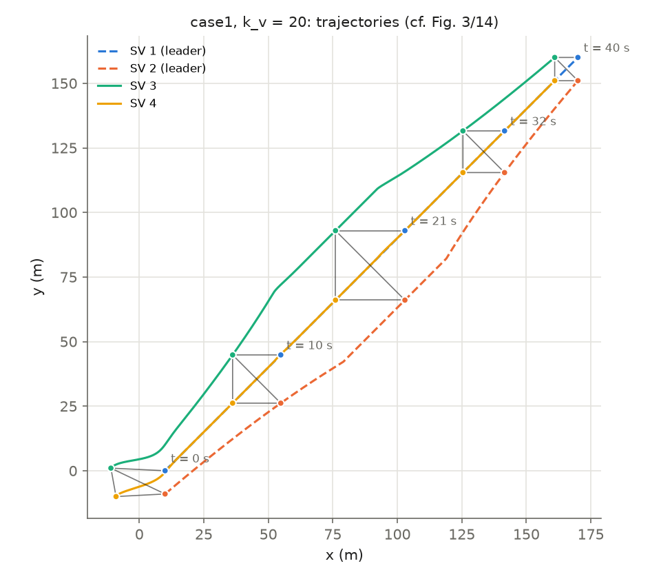
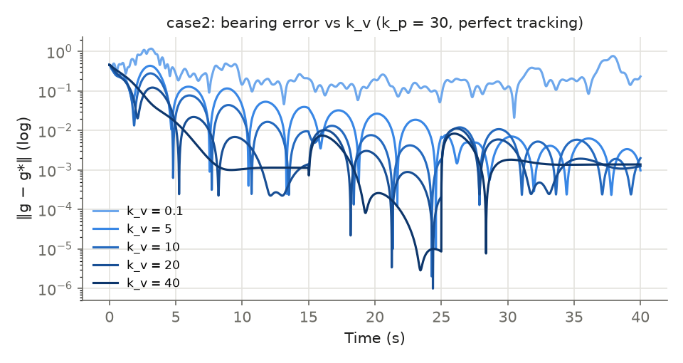
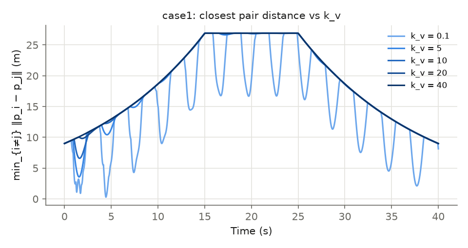
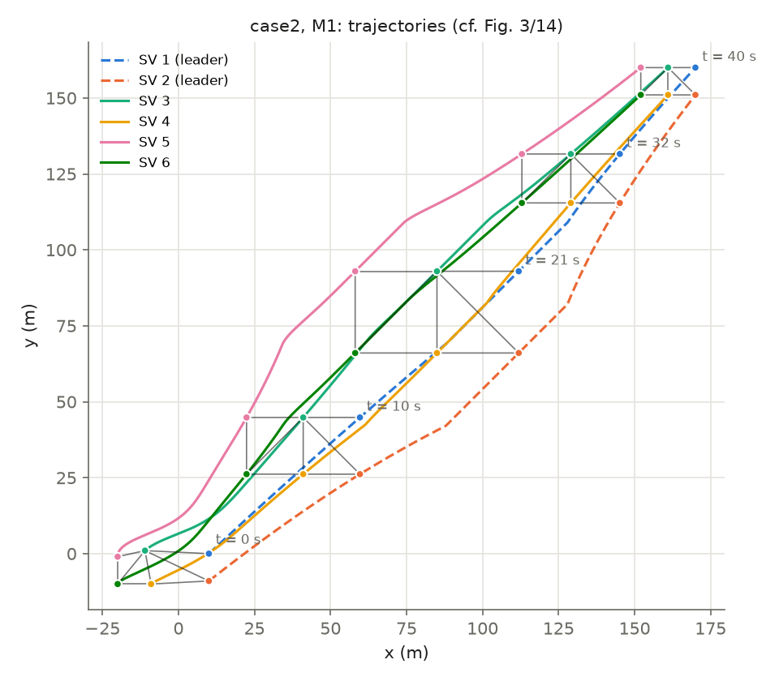
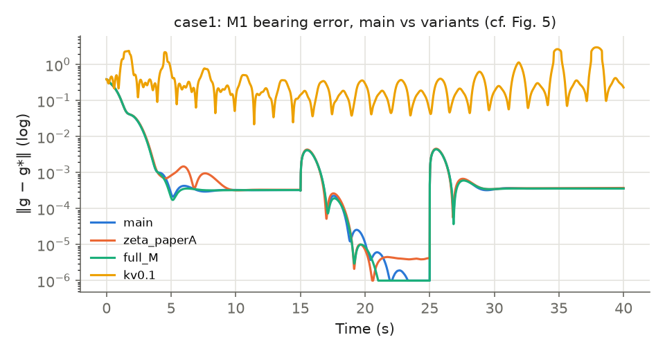
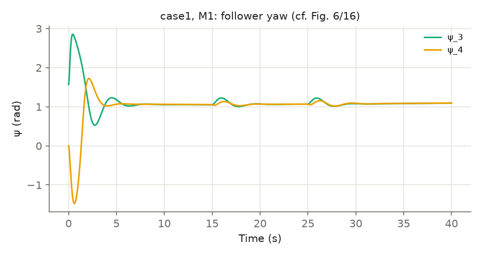

# Hình chọn lọc

Toàn bộ hình sinh lại được bằng các script trong `scripts/` (xem `docs/replication_report.md`).

## Mốc 2: tầng cao riêng, tàu thật bám hoàn hảo tàu ảo

| Hình | Nội dung |
| --- | --- |
|  | Case 1 với **k_v = 0.1 như Paper A**: follower đi đường ngoằn ngoèo suốt 40 s; có lúc hai tàu cách nhau chỉ 0.29 m. |
|  | Case 1 với k_v = 20 (đã chọn): hội tụ trong khoảng 3 s, giữ hình vuông qua cả ba pha co giãn. |
|  | Case 2, quét k_v: chỉ k_v = 40 dập được mode chậm (λ_min = 0.039). |
|  | Case 1, khoảng cách nhỏ nhất giữa hai tàu theo k_v. Cản kém thì tàu tiến sát nhau, đây là động lực cho phần CBF. |

## Mốc 3: chạy kín với plant thật và baseline M1 ([L21] (27) = (62) của Paper A)

| Hình | Nội dung |
| --- | --- |
|  | Case 1, M1: quỹ đạo và các ảnh chụp đội hình (so với Hình 3). |
|  | Case 2, M1 (so với Hình 14). |
|  | Sai số bearing của M1: cấu hình chính và các biến thể. ζ của Paper A cho RMSE gần như y hệt dù bám vận tốc kém: chỉ số bearing không nhạy với tầng thấp. |
|  | Góc hướng: quá độ lớn ở 2 s đầu; xác lập ở khoảng 1.08 rad thay vì π/4, vì M1 không bù mô-men nhiễu δ_r. |
|  | Sai số vận tốc surge: xác lập khoảng δ_u/k_u ≈ 0.15 m/s (so với Hình 8). |
|  | Lực surge: khoảng 1100 N khi chạy đều, khớp mức lực ở Hình 9a. |
