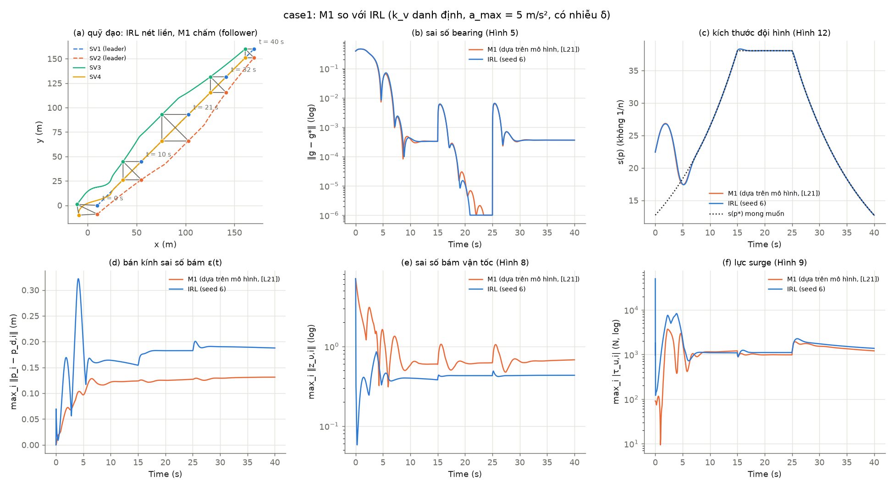

# Báo cáo tái tạo Paper A

**Paper A:** H. A. N. Duc, M. H. Phung, P. N. Dao, *Bearing-based cascade formation scaling control for multiple perturbed surface vehicles via off-policy reinforcement learning*, J. Franklin Institute 363 (2026) 109193.

Ngày 28/11/2026. Người làm: Tô Minh Đức (cùng coding agent). Code: github.com/tominhducsp17-glitch/Bearing_collision_avoidance.

Tái tạo bằng Python, không có code gốc (code của nhóm tác giả đã mất). Chi tiết từng mốc: `docs/replication_report.md`. Danh sách giả thiết đánh số: `docs/assumptions.md`. Sổ phát hiện: `docs/findings.md`.

---

## 0. Tóm tắt

1. **Đã tái tạo được phần khung của Paper A.** Cascade bearing (13) → tàu ảo → tầng thấp chạy được ở cả Case 1 (4 tàu) và Case 2 (6 tàu). Đội hình hội tụ, kích thước bám đúng lịch (63), và mức lực khớp Hình 9. Algorithm 2 (H∞ IRL off-policy) cài đúng: trên bài toán đồ chơi biết trước lời giải, nó khớp nghiệm ARE tới sai số 1e-10.
2. **Làm y hệt những gì bài in ra thì không chạy được.** Có ít nhất 6 chỗ nằm trong số này: k_v = 0.1; R = I; W⁽⁰⁾ = 0; dấu của ρ₂ trong (58)–(59); R_p trong (9); hệ số ζ của M1. Thêm vào đó, bài không mô tả pha thu dữ liệu. Ta đã sửa từng chỗ, có bằng chứng (mục 3).
3. **Sau khi sửa, IRL chạy ổn định ở 10/10 seed** ở cả hai case.
4. **Nhưng IRL không vượt M1 như Bảng 1.** Theo Bảng 1, RMSE bearing của IRL chỉ bằng 16–23 % của M1; ở đây hai phương pháp ngang nhau (tỉ lệ khoảng 1.0). IRL bám vị trí còn kém hơn M1; bù lại, IRL có ưu điểm rõ ở góc hướng (mục 2.3).
5. **Có 6 câu nên hỏi thầy** (mục 4). Đó là những chỗ mà nếu ta tự quyết sai thì baseline "Paper A" của ta không còn là Paper A nữa. Quan trọng nhất là pha thu dữ liệu, và việc tầng thấp có thành phần bù mô hình hay không.

---

## 1. Phạm vi

| Có làm | Không làm |
|---|---|
| Mô hình tàu (1) có nhiễu δ(t) của bài; leader là điểm động học | M2, M3, M4 của Bảng 1 (cần đọc bài gốc của từng phương pháp) |
| Tầng cao: (9), (12)–(14), lịch co giãn (63) | Tái tạo khớp từng con số của Bảng 1 (bảng tự mâu thuẫn, xem 3.4) |
| Tầng thấp: backstepping (15)–(17); M1 = (62); H∞ IRL off-policy, Algorithm 2 | |
| Case 1, Case 2, 40 s, RK4 với dt = 1 ms | |
| 48 test tự động; lời giải tham chiếu (ARE, phép lặp dùng mô hình) để đối chiếu | |

## 2. Kết quả

### 2.1 Những gì khớp với Paper A

| Nội dung | Paper A | Ta | Hình |
|---|---|---|---|
| Kích thước đội hình s(p) (Case 1, không chia 1/n) | ≈ 12.7 → 38 → 12.7 (Hình 12a) | 12.73 → 38.05 → 12.73 | `figures/report/case1_overview.png` (c) |
| Lực surge khi chạy đều | ≈ 1100 N (Hình 9a) | ≈ 1100 N (SV3), 700–1700 N (SV4) | (f) |
| Góc hướng follower dưới IRL | hội tụ về π/4 trong khoảng 1 s (Hình 6) | IRL: về gần π/4 trong khoảng 1 s | `figures/report/case1_yaw.png` |
| Trọng số hội tụ sau vài vòng | 7–20 vòng (Hình 10, 18) | vòng được chọn: 2–17 (trên 10 seed, mọi follower) | `figures/report/case1_learning.png` |
| Algorithm 2 đúng về toán | — | khớp nghiệm ARE (sai số 1e-10 đến 1e-7) và khớp phép lặp dùng mô hình **ở từng vòng** | `figures/moc4/convergence.png` |



*Case 1, M1 (cam) so với IRL (xanh). (a) quỹ đạo kèm ảnh chụp đội hình; (b) sai số bearing; (c) kích thước đội hình; (d) bán kính sai số bám ε(t) = max_i ‖p_i − p_d,i‖; (e) sai số vận tốc; (f) lực surge. Case 2: `figures/report/case2_overview.png`. Ảnh động: `figures/report/case1_animation.gif`.*

### 2.2 Bảng chỉ số (cấu hình chính, a_max = 5 m/s², có nhiễu δ)

IRL: trung vị [min, max] trên 10 seed của pha học. Bảng đầy đủ: `docs/moc6_table.md`.

| | Case 1, M1 | Case 1, IRL | Case 2, M1 | Case 2, IRL |
|---|---|---|---|---|
| RMSE bearing | 0.116 | 0.117 [0.114, 0.118] | 0.122 | 0.122 [0.120, 0.137] |
| IAE | 1.54 | 1.56 [1.50, 1.65] | 1.68 | 1.69 [1.65, 2.45] |
| ε_max khi t ≥ 5 s (m) | 0.13 | 0.21 [0.12, 0.60] | 0.13 | 0.48 [0.11, 0.66] |
| \|z_r\| xác lập (rad/s) | 0.60 | 0.11 (seed đại diện) | 0.60 | 0.28 (seed đại diện) |
| Tổng lực Σ∫\|τ\| | 1.16e5 | 1.26e5 [1.24e5, 1.67e5] | 2.40e5 | 2.57e5 [2.53e5, 3.53e5] |
| max\|τ\| khi t ≥ 0.1 s | 3.7e3 | 7.5e3 [5.9e3, 1.4e4] | 4.0e3 | 6.3e3 [5.8e3, 2.4e4] |
| Khoảng cách nhỏ nhất giữa hai tàu (m) | 8.99 | 8.99 | 8.97 | 8.97 |

Bảng 1 của Paper A: RMSE của M1 là 0.1136 (Case 1) và 0.2903 (Case 2); của IRL là 0.0178 và 0.0678. Số tuyệt đối không so được (mục 3.4), nên chỉ so **tỉ lệ IRL/M1**:

| | Paper A | Ta |
|---|---|---|
| RMSE IRL / M1, Case 1 | 0.16 | 1.00 |
| RMSE IRL / M1, Case 2 | 0.23 | 1.00 |

### 2.3 Những gì không khớp, và vì sao

1. **IRL không vượt M1 về sai số bearing.** Ta thấy hai lý do.
   - (a) Sai số bearing gần như không nhạy với tầng thấp. (13) dùng vị trí *tàu thật*, nên tàu ảo tự chạy lệch để bù phần trễ của tàu thật. Ở Mốc 3, một M1 bám vận tốc rất kém (sai số khoảng 3 m/s) vẫn cho RMSE bearing bằng cấu hình chính tới 3 chữ số. Vì vậy chỉ số của Bảng 1 khó phân biệt được tầng thấp tốt hay kém.
   - (b) M1 của ta dùng đúng mô hình mà plant dùng, nên gần như là cận trên của bộ phản hồi. IRL phải tự học, và cơ sở hàm bị cắt chỉ khớp tàu phi tuyến ở mức khoảng 1 %.

   Cần nói rõ: Paper A có thể đã cài M1 khác ta (xem câu hỏi Q5).
2. **IRL có ưu điểm thật ở góc hướng.** M1 không bù nhiễu, nên sai số yaw-rate xác lập là δ_r/k_r ≈ 0.6 rad/s, và góc hướng dừng ở khoảng 1.08 rad thay vì π/4. IRL có thành phần theo υ_d bù được một phần nhiễu, nên góc hướng về gần π/4. **Hình 6 của Paper A lại cho cả M1 về π/4**; ta chưa giải thích được điều này (Q5).
3. **IRL bám vị trí kém hơn M1** (ε lớn hơn 1.5–3.5 lần), và có đỉnh lực lớn ở bước t = 0. Đỉnh này xuất hiện vì ω_d nhảy bậc lúc khởi động (z_r ≈ 7 rad/s) nhân với khuếch đại cỡ 10⁴.
4. **Quá độ của ta nhỏ hơn Hình 8, 17, 20 của Paper A** (ở bài, z_υ lên tới hàng trăm và τ lên cỡ 10⁵). Lý do là ta giới hạn ‖Π‖ ≤ 5 m/s² (mục 3.3). Không có giới hạn này thì (13) cho gia tốc tham chiếu 300–470 m/s² ở giây đầu, phù hợp với các quá độ khổng lồ trong hình của bài.
5. **Với đúng k_v = 0.1 của bài, không thể ra Hình 3 và 5.** Đội hình dao động suốt 40 s, và hai tàu tiến sát nhau tới 0.16–0.29 m (mục 3.1).

## 3. Các thay đổi so với Paper A

Ba nhóm: (3.1) bài in sai, làm đúng như in thì không chạy; (3.2) bài không nói, ta phải tự quyết; (3.3) ta thêm vào để chạy được. Số trong ngoặc là số mục ở `docs/assumptions.md`.

### 3.1 Bài in sai: làm đúng như in thì không ra kết quả

| # | Paper A | Vấn đề (bằng chứng) | Ta làm | Ảnh hưởng |
|---|---|---|---|---|
| S1 | k_p = 30, **k_v = 0.1**, "đặt giống nhau cho mọi phương pháp" | Tầng cao gần như không có cản: hệ số cản ζ ≈ 0.003–0.014; mode chậm nhất cần khoảng 138 s (Case 1) và 508 s (Case 2) mới tắt, trong khi Hình 5 hội tụ dưới 1 s. Ngay cả khi bám hoàn hảo, hai tàu tiến sát nhau tới 0.29 m. Bài [Z23] cùng dạng luật dùng k_v/k_p = 2.5 | k_v = 20 (Case 1), 40 (Case 2), chọn theo ζ ≥ 0.7 của mode chậm nhất (K2). k_v = 0.1 chạy như biến thể đối chứng | Mọi hình và bảng |
| S2 | **R = I** trong hàm chi phí (22) | Với R = I, nghiệm tối ưu *thật* của chính bài toán này cho tàu trễ sau tàu ảo khoảng **123 m** (lời giải tham chiếu H∞ tuyến tính hóa): bù lực cản 1100 N bị phạt quá nặng dưới chiết khấu α = 0.1. Hình 8–9 cho thấy khuếch đại hiệu dụng khoảng 7000 N/(m/s), không thể có với R = I | R = diag(1/τ_nom²), τ_nom = (1100, 300, 30): trễ chỉ khoảng 4.5 mm, khuếch đại cỡ 10⁴ (K4) | Toàn bộ tầng thấp IRL |
| S3 | **W_a⁽⁰⁾ = W_c⁽⁰⁾ = W_d⁽⁰⁾ = 0** | τ = 0 không phải chính sách chấp nhận được: hệ sai số không ổn định (trị riêng +1.05, do số hạng +β_η của backstepping). Phép lặp chính sách xuất phát từ 0, kể cả bản *dùng mô hình*, hội tụ về một nghiệm ARE **sai** (có test) | W_a⁽⁰⁾ = phần P của chính sách hành vi (mục 8) | Hội tụ của Algorithm 2 |
| S4 | Dấu của ρ₂ trong (58)–(59) | Ngược dấu so với (45) và [M15] (77). Bài toán đồ chơi xác nhận dấu đúng | ρ₂ = −∫w(XᵀQ'X + ûᵀRû − γ²d̂ᵀd̂) (B-5) | Algorithm 2 |
| S5 | (9): ϑ_i = R_p(ψ_i)(…) | ϑ là vận tốc hệ thân, nên phải là R_pᵀ. Dùng R_p thì leader đi theo hướng (−4, 4), trái với Hình 3 | R_pᵀ (B-1) | Quỹ đạo leader |
| S6 | M1 (62) với ζ = (0.5, 0.7, 0.5) | Sai số vận tốc xác lập ≈ δ/ζ ≈ 6 m/s; góc hướng dừng ở khoảng 3.65 rad (tàu gần như chạy ngược) | Hệ số (20, 12, 5) của bài gốc phương pháp [L21] (B-14); ζ của Paper A chạy như biến thể | Độ công bằng khi so M1 với IRL |
| S7 | (14) với ψ của tàu thật | Với k_ω = 25 (theo [L21]), ψ_d tích phân một ω_d rất lớn trong lúc tàu thật chưa kịp quay, nên trôi tới khoảng 12 rad (tàu quay gần 2 vòng) | Dùng ψ_d của tàu ảo, k_ω = 3 (mục 4) | Quá độ góc hướng |

**Bảng biến thể "làm đúng như bài" trên Case 1** (cùng pha thu dữ liệu và bước kiểm định của ta; `results/moc5_irl/case1_table.md`):

| Biến thể (chỉ đổi một thứ so với cấu hình chính) | RMSE bearing | ε_max khi t ≥ 5 s | max\|τ\| | Kết quả |
|---|---|---|---|---|
| M1 ([L21]) | 0.1165 | 0.13 m | 3.7e3 | ổn |
| IRL, cấu hình chính của ta | 0.1163 | 0.40 m | 1.3e4 | ổn |
| IRL, **cơ sở đúng chữ** X(1..9) = [z; p_d; ψ_d] (U3) | 0.1155 | 0.88 m | 9.8e4 | chạy được, nhưng bám kém gấp khoảng 2 lần, đỉnh lực gấp khoảng 8 lần |
| IRL, **R = I** như bài (S2) | 2.27 | khoảng 4 km | 1.1e5 | tàu thật bỏ xa tàu ảo (đúng như lời giải tham chiếu dự đoán) |
| IRL, **W⁽⁰⁾ = 0** như bài (S3) | — | — | — | **phân kỳ** ở t = 0.004 s |

Biến thể "thu dữ liệu trong lúc chạy kịch bản đội hình" (U1) không có trong bảng, vì ngay pha học đã cho khuếch đại sai dấu (`tests/test_irl_vessel.py::test_non_autonomous_reference_breaks_learning`). Ghi chú: với lưới dữ liệu chỉ có u (v_d = ω_d = 0), ρ₁ có hạng 70/99. Các trọng số theo v_d và ω_d không xác định được, nên được giải theo nghiệm chuẩn nhỏ nhất (bằng 0); khi triển khai, các đặc trưng đó vì vậy không có tác dụng.

### 3.2 Bài không nói rõ: ta tự quyết

| # | Chỗ thiếu | Ta chọn | Cơ sở | Độ nhạy của kết quả |
|---|---|---|---|---|
| U1 | **Pha thu dữ liệu**: chính sách hành vi, thời lượng, kịch bản thu | Thu nhiều đợt 5 s, mỗi đợt một tham chiếu vận tốc thân tàu **hằng** (u_d ∈ {5, 5.66, 6.3} m/s, v_d = ω_d = 0, lặp 3 lần); chính sách hành vi PI cộng 20 sin; sai số ban đầu ngẫu nhiên (K1) | Thu trong lúc chạy kịch bản đội hình (cách tự nhiên nhất, ta thử đầu tiên) **vi phạm giả thiết tự trị** của (20) và [M15]: tham chiếu phụ thuộc thời gian, láng giềng, và cả tàu thật. Bình phương tối thiểu khi đó cho khuếch đại sai dấu và phân kỳ (có test) | **Rất lớn**: quyết định IRL có chạy được hay không |
| U2 | Chọn vòng lặp nào để dùng | Kiểm định mỗi vòng bằng một lần chạy thử 5 s không cần mô hình; chọn vòng có chi phí (22) thấp nhất; chỉ chấp nhận nếu tốt hơn chính sách hành vi, nếu không thì thu thêm dữ liệu (tối đa 5 lô) | Không kiểm định thì phép lặp trôi dần sang một nghiệm Riccati sai dấu ở nhiều seed (dữ liệu tàu thật chỉ khớp hàm V bậc hai ở mức khoảng 1 %) | **Lớn**: không có bước này thì phân kỳ ở mọi biến thể |
| U3 | X(1..9) dùng cho actor là gì | [z_η; z_υ; υ_d] (B-10) | Đúng chữ (20)–(21) thì X(1..9) = [z; p_d; ψ_d], tức chứa **vị trí tuyệt đối** p_d (từ 0 đến 160 m): chính sách không bất biến tịnh tiến và phải ngoại suy rất xa vùng dữ liệu | Lớn (xem bảng biến thể) |
| U4 | β_η của backstepping | 2·I₃ | [N24] dùng β_η = 2 với cùng luật | Nhỏ |
| U5 | k_ω, b_i của (14) | k_ω = 3, b_i theo [L21] (6) | ψ hội tụ trong khoảng 1 s như Hình 6 | Nhỏ |
| U6 | Tâm co giãn c trong (9) | Tâm của đội hình đích trên mọi n tàu (B-2) | Khớp số đọc trên Hình 12 và mức lực ở Hình 9 | Nhỏ |
| U7 | Trạng thái đầu của tàu ảo | η_d(0) = η(0), υ_d(0) = 0 (B-7) | Lựa chọn tự nhiên nhất | Nhỏ |
| U8 | Leader | Điểm động học, không có nhiễu (mục 13) | Trang 19: "we only control two followers" | Nhỏ |
| U9 | Cách hiểu M1 (62): υ_e, Ξ_ε | υ_e = z_υ, Ξ = α̇_v (cách hiểu B, B-14) | Cách hiểu này có phản hồi vị trí qua (16) | Trung bình |
| U10 | Định nghĩa chỉ số | e = sqrt(Σ_cạnh ‖g − g*‖²); RMSE = sqrt((1/40)∫e²) (B-8) | Bảng 1 tự mâu thuẫn (3.4) | Chỉ ảnh hưởng số tuyệt đối |

### 3.3 Ta thêm vào (bài không có)

| # | Thêm | Lý do |
|---|---|---|
| A1 | **‖Π‖ ≤ a_max = 5 m/s²** cho mọi phương pháp, kể cả M1 (B-16) | Không có giới hạn này thì gia tốc tham chiếu ban đầu là 300–470 m/s² (30–50 g), đẩy tầng thấp đã học ra khỏi vùng dữ liệu và gây phân kỳ. a_max = 3 cho hội tụ quá chậm |
| A2 | Bước kiểm định và chấp nhận (U2) | Xem trên |
| A3 | Chuẩn hóa R (S2), khởi tạo từ chính sách hành vi (S3) | Xem trên |

Các thay đổi A1–A3 **không phải đóng góp của bài mới** (Đức chốt 27/11): chúng chỉ là chi tiết cài đặt để baseline chạy được, sẽ ghi trong phần cài đặt.

### 3.4 Chỗ tự mâu thuẫn trong bài (chỉ ghi nhận)

- **Bảng 1:** IAE = 37.2 trong 40 s nghĩa là e trung bình ≈ 0.93. Theo Cauchy–Schwarz, khi đó RMSE ≥ 0.93 (định nghĩa chuẩn), hoặc ≥ 0.029 (định nghĩa theo chữ, với N = 40 000). Cả hai đều mâu thuẫn với 0.0178. Cận tích phân in là ∫₀⁵⁰⁰, trong khi mô phỏng chạy 40 s. Chú thích bảng ghi "Fig. 12", đúng ra là Hình 5.
- **Hình 12 (Case 2):** s ban đầu khoảng 24, trong khi tính từ trạng thái đầu đã cho ra 32.8.
- **Sai số Bellman:** Hình 11 cho cỡ 25, Hình 19 cho cỡ 5·10⁻⁴.
- **Định lý 1:** chứng minh viết V\*(z) và coi nó xác định dương theo z, trong khi V\* là hàm của X = [z; Ω], và V\*([0, Ω]) ≠ 0. Kết luận UUB có lẽ vẫn đúng cục bộ, nhưng phát biểu cần sửa.

## 4. Câu hỏi nên hỏi thầy

Chỉ liệt kê những chỗ mà **việc ta tự quyết có thể làm sai hướng**, nghĩa là baseline của ta có thể không còn là phương pháp của Paper A. Những chỗ ta đã tự giải quyết có bằng chứng (S4, S5, S7, U4–U8, U10) thì không cần hỏi.

| # | Câu hỏi | Vì sao quan trọng | Nếu câu trả lời khác với lựa chọn của ta |
|---|---|---|---|
| **Q1** | **Dữ liệu cho pha học được thu thế nào?** Chính sách hành vi là gì? Thu riêng trước khi chạy, hay trong lúc chạy kịch bản đội hình? Thu bao lâu? | Bài không mô tả. Thu trong lúc chạy đội hình thì phương trình Bellman off-policy không còn đúng (ta đã chứng minh bằng số), nên Algorithm 2 không thể hội tụ như Hình 10, 18. Nếu nhóm đã thu như vậy mà vẫn chạy, thì phải có một thành phần nào đó mà bài không ghi | Phải làm lại pha 1 (Mốc 5) theo đúng cách của nhóm và kiểm lại mọi kết quả IRL |
| **Q2** | **Tầng thấp có thành phần bù mô hình (feedforward) như bài tiền thân [N24] không? R có thật là I không?** | Với R = I, nghiệm tối ưu thật cho tàu trễ 123 m; hình của bài lại cho bám rất chặt. Hai khả năng: R thật khác I, hoặc có feedforward dựa trên mô hình. Nếu có feedforward thì phương pháp không còn "hoàn toàn không cần mô hình", và IRL của ta (RL thuần) là một phương pháp khác | Thêm khâu bù mô hình vào IRL (đã có sẵn biến thể theo [N24]), học lại, so lại với M1 |
| **Q3** | **k_v có thật là 0.1 không?** Và (13) dùng vị trí tàu thật hay tàu ảo? | Với k_v = 0.1, tầng cao gần như không có cản, không thể ra Hình 3, 5. Ta dùng 20/40, lệch bài. Câu này cũng quyết định kịch bản S0 của giai đoạn 2, vốn được dựng trên giả định "k_v = 0.1 là của bài" | Nếu có giá trị khác thì chạy lại Mốc 2, 3, 6 với giá trị đó (khoảng 15 phút) |
| **Q4** | **Code gốc có giới hạn hay bão hòa gia tốc tham chiếu, hoặc lực τ, không?** | Ta thêm ‖Π‖ ≤ 5 m/s² cho mọi phương pháp; không có nó thì IRL phân kỳ. Hình 8, 17, 20 cho thấy quá độ khổng lồ, gợi ý bài không giới hạn. Nếu bài không giới hạn mà vẫn chạy được, thì cách học của nhóm phủ được vùng gia tốc đó, và ta đang thiếu một điều gì đó ở Q1 | Nếu có bão hòa lực thì thêm vào mô hình; nếu không có giới hạn nào thì cần làm rõ Q1 |
| **Q5** | **M1 trong Bảng 1 được cài và chỉnh thế nào?** Hệ số ζ có nhân khối lượng không? M1 có chịu cùng nhiễu δ không? | Với ζ in trong bài, M1 hỏng góc hướng. Với hệ số của [L21], M1 ngang IRL. Hình 6 của bài lại cho M1 về π/4, điều không thể xảy ra nếu M1 không bù nhiễu và chịu cùng δ. Câu này quyết định kết luận "IRL tốt hơn M1" của bài có tái tạo được hay không | Cài lại M1 theo đúng cách của nhóm; nếu ra tỉ lệ RMSE như Bảng 1 thì kết luận của bài đứng được trong điều kiện đó |
| **Q6** | X(1..9) dùng cho actor có thật là [z; p_d; ψ_d] (đúng chữ, chứa vị trí tuyệt đối) không? | Đúng chữ thì chính sách phụ thuộc vị trí tuyệt đối, ngoại suy rất kém (xem bảng biến thể) | Chạy lại với cơ sở đúng chữ làm cấu hình chính |

Gợi ý cách hỏi: Q1, Q2, Q4 có thể gộp thành một câu "nhóm đã thu dữ liệu và cấu hình hàm chi phí của tầng thấp như thế nào". Q3, Q5 hỏi về tham số. Không cần hỏi về Bảng 1 (3.4), vì ta chỉ so tỉ lệ giữa các phương pháp.

## 5. Cách chạy lại và xem kết quả

Môi trường: Python 3.13 trong `.venv` (tạo bằng `uv`). Các gói: numpy, scipy, matplotlib, pyyaml, pytest, quadprog.

```bash
# Toàn bộ, dùng lại trọng số IRL đã học (khoảng 10 phút):
bash scripts/run_all.sh quick
# Toàn bộ, học lại IRL 10 seed cho cả hai case (khoảng 45–60 phút):
bash scripts/run_all.sh full

# Từng phần:
.venv/bin/python -m pytest -q                           # 48 test, khoảng 35 s
.venv/bin/python scripts/check_geometry.py              # Mốc 1: hình học, phân tích cản của k_v
.venv/bin/python scripts/run_highlevel_only.py          # Mốc 2: tầng cao, quét k_v (cả 0.1 của bài)
.venv/bin/python scripts/run_m1.py                      # Mốc 3: M1 và các biến thể (ζ của bài, M đầy đủ, k_v = 0.1)
.venv/bin/python scripts/toy_irl.py                     # Mốc 4: Algorithm 2 trên bài đồ chơi, so với ARE
.venv/bin/python scripts/run_irl.py case1 --seeds 10    # Mốc 5: học IRL 10 seed (khoảng 10–25 phút)
.venv/bin/python scripts/run_irl.py case1               # Mốc 5: biến thể đúng như bài (R = I, W = 0, cơ sở đúng chữ)
.venv/bin/python scripts/run_moc6.py                    # Mốc 6: M1 so với IRL, 10 seed
.venv/bin/python scripts/make_report_figures.py         # hình của báo cáo này, kể cả ảnh động
```

Hình của báo cáo (`results/report/`, bản chọn lọc ở `docs/figures/report/`):

| File | Nội dung | Tương ứng Paper A |
|---|---|---|
| `<case>_overview.png` | 6 ô: quỹ đạo kèm ảnh chụp đội hình, sai số bearing, kích thước đội hình, ε(t), sai số vận tốc, lực surge; M1 và IRL trên cùng một ô | Hình 3/14, 5, 12, 8/17, 9/20 |
| `<case>_yaw.png` | Góc hướng follower, M1 và IRL | Hình 6/16 |
| `case1_learning.png` | Algorithm 2 trên từng follower: ‖Ŵ‖, sai số Bellman trên dữ liệu giữ lại, chi phí kiểm định và vòng được chọn | Hình 10/18, 11/19 |
| `<case>_animation.gif` | Ảnh động M1 và IRL chạy cạnh nhau, đội hình đích p\* mờ phía sau | (bài không có) |

Cách vẽ theo lối các bài cùng hướng: quỹ đạo kèm ảnh chụp đội hình ở các mốc thời gian, cộng đồ thị kích thước đội hình theo thời gian (như [L21] và Zhang et al. TASE 2024), và khoảng cách nhỏ nhất giữa các tàu theo thời gian (như Molnar–Ames 2021 và Naeem–Haque 2026 dùng cho phần an toàn). Hình khoảng cách nhỏ nhất đã có ở `figures/moc7/` cho giai đoạn 2.
